# DeepLense: Vision Transformers for Dark Matter Substructure Classification
### Complete Guide to Physics, Telescopes, Code Architecture, and Model Zoo
*Author Reference: GSoC Project by Archil Srivastava ([@archilk](https://github.com/archilk)) | DeepLense / ML4SCI*

---

## Table of Contents
1. [Executive Summary & Problem Statement](#1-executive-summary--problem-statement)
2. [Astrophysics & Strong Gravitational Lensing Physics](#2-astrophysics--strong-gravitational-lensing-physics)
   - [2.1 Physical Foundations of Strong Gravitational Lensing](#21-physical-foundations-of-strong-gravitational-lensing)
   - [2.2 Why "No Substructure" is Physically Impossible in Reality](#22-why-no-substructure-is-physically-impossible-in-reality)
   - [2.3 The Sérsic Light Profile in Depth](#23-the-sérsic-light-profile-in-depth)
   - [2.4 Telescope Observation Characteristics: Model I vs. Model II (Euclid) vs. Model III (HST)](#24-telescope-observation-characteristics-model-i-vs-model-ii-euclid-vs-model-iii-hst)
3. [Deep Learning Pipeline & Code Architecture Walkthrough](#3-deep-learning-pipeline--code-architecture-walkthrough)
   - [3.1 How `train.py` Works: Step-by-Step Architecture](#31-how-trainpy-works-step-by-step-architecture)
   - [3.2 Exhaustive CLI Arguments & Parameter Definitions](#32-exhaustive-cli-arguments--parameter-definitions)
   - [3.3 Dataset Pipeline, Preprocessing, and Center-Cropping Rationale](#33-dataset-pipeline-preprocessing-and-center-cropping-rationale)
   - [3.4 Classification Heads: Simple vs. Complex MLP](#34-classification-heads-simple-vs-complex-mlp)
4. [How Results and Metrics are Formed & Calculated](#4-how-results-and-metrics-are-formed--calculated)
   - [4.1 Logits to Probabilities via Softmax](#41-logits-to-probabilities-via-softmax)
   - [4.2 Cross-Entropy Loss Calculation](#42-cross-entropy-loss-calculation)
   - [4.3 Accuracy Metric](#43-accuracy-metric)
   - [4.4 ROC Curves (Receiver Operating Characteristic)](#44-roc-curves-receiver-operating-characteristic)
   - [4.5 AUROC: Class-Wise, Macro, and Micro Calculation](#45-auroc-class-wise-macro-and-micro-calculation)
   - [4.6 Confusion Matrix Construction](#46-confusion-matrix-construction)
5. [Comprehensive Model Zoo & Architectural Breakdown](#5-comprehensive-model-zoo--architectural-breakdown)
   - [5.1 Inductive Bias: Convolutions vs. Self-Attention in Lensing](#51-inductive-bias-convolutions-vs-self-attention-in-lensing)
   - [5.2 Vision Transformer (ViT)](#52-vision-transformer-vit)
   - [5.3 EfficientNet (Compound Scaling Baseline)](#53-efficientnet-compound-scaling-baseline)
   - [5.4 Bottleneck Transformers (BoTNet)](#54-bottleneck-transformers-botnet)
   - [5.5 CoaT (Co-scale Conv-attentional Transformer)](#55-coat-co-scale-conv-attentional-transformer)
   - [5.6 CoAtNet (Convolution and Attention Networks)](#56-coatnet-convolution-and-attention-networks)
   - [5.7 EfficientFormer (Latency-Driven Mobile Vision Transformer)](#57-efficientformer-latency-driven-mobile-vision-transformer)
   - [5.8 CrossViT (Dual-Branch Cross-Attention Multi-Scale Transformer)](#58-crossvit-dual-branch-cross-attention-multi-scale-transformer)
   - [5.9 ConViT (Gated Positional Self-Attention Transformer)](#59-convit-gated-positional-self-attention-transformer)
6. [Comparative Summary & Takeaways for Dark Matter Inference](#6-comparative-summary--takeaways-for-dark-matter-inference)

---

## 1. Executive Summary & Problem Statement

The goal of this project within **ML4SCI (Machine Learning for Science)** is to infer the nature and distribution of **dark matter** on sub-galactic scales using **strong gravitational lensing** images and modern **Vision Transformers (ViTs)** and hybrid architectures.

In strong gravitational lensing, the gravitational potential of an intermediate massive galaxy (the "lens") bends the light emitted by a background galaxy (the "source"), forming distorted arcs, rings (Einstein rings), and multiple images. Small clumps of dark matter (subhalos) or alternative dark matter configurations (such as quantum axion vortices) embedded within the host lens distort these rings in subtle, localized ways.

This project trains and benchmarks state-of-the-art vision models from `timm` (PyTorch Image Models) to classify lensing images into **three fundamental classes**:
1. `axion`: Ultralight / Fuzzy Dark Matter manifesting as wave interference and quantum vortex substructures.
2. `cdm`: Standard Cold Dark Matter characterized by compact point-mass / NFW subhalos.
3. `no_sub`: A smooth, idealized host halo baseline without localized substructure.

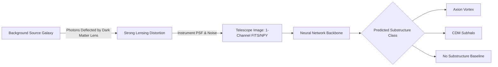

---

## 2. Astrophysics & Strong Gravitational Lensing Physics

### 2.1 Physical Foundations of Strong Gravitational Lensing

According to Einstein's General Theory of Relativity, mass curves spacetime. Light follows null geodesics in this curved metric. When light from a distant source galaxy at redshift $z_s$ passes near a massive lens galaxy at redshift $z_l$ (with $z_l < z_s$), its trajectory is deflected by an angle $\hat{\vec{\alpha}}$.

The relation between the true source angular position $\vec{\beta}$ and the observed image angular position $\vec{\theta}$ is governed by the **lens equation**:

$$\vec{\beta} = \vec{\theta} - \vec{\alpha}(\vec{\theta})$$

where the scaled deflection angle $\vec{\alpha}(\vec{\theta})$ is related to the physical deflection angle $\hat{\vec{\alpha}}$ by angular diameter distances:

$$\vec{\alpha}(\vec{\theta}) = \frac{D_{ls}}{D_s} \hat{\vec{\alpha}}(\vec{\theta})$$

Here:
- $D_l$: Angular diameter distance from observer to lens.
- $D_s$: Angular diameter distance from observer to source.
- $D_{ls}$: Angular diameter distance from lens to source.

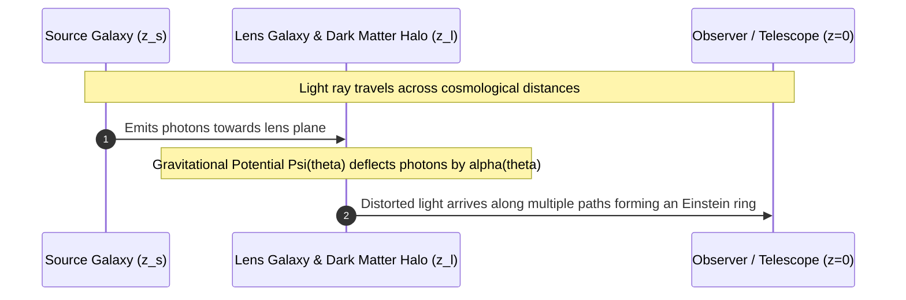

The deflection angle is the gradient of the 2D projected gravitational potential $\psi(\vec{\theta})$:

$$\vec{\alpha}(\vec{\theta}) = \vec{\nabla}_{\theta} \psi(\vec{\theta})$$

The 2D dimensionless surface mass density (convergence) $\kappa(\vec{\theta})$ satisfies the 2D Poisson equation:

$$\nabla^2 \psi(\vec{\theta}) = 2 \kappa(\vec{\theta}), \quad \kappa(\vec{\theta}) \equiv \frac{\Sigma(\vec{\theta})}{\Sigma_{\text{crit}}}$$

where $\Sigma(\vec{\theta})$ is the projected physical surface mass density ($\text{kg}/\text{m}^2$ or $M_\odot/\text{kpc}^2$), and $\Sigma_{\text{crit}}$ is the critical surface mass density:

$$\Sigma_{\text{crit}} = \frac{c^2}{4\pi G} \frac{D_s}{D_l D_{ls}}$$

When $\kappa \ge 1$ near the center of the lens, multiple images and extended arcs/Einstein rings form. For an axially symmetric lens of total mass $M$, the radius of the ring is the **Einstein Radius** $\theta_E$:

$$\theta_E = \sqrt{\frac{4GM}{c^2} \frac{D_{ls}}{D_l D_s}}$$

---

### 2.2 Why "No Substructure" is Physically Impossible in Reality

In the DeepLense datasets, class 2 is designated as **"no_sub" (No Substructure)**. The project documentation notes:
> *"this doesn’t occur observationally as there is always a substructure in reality, but we use this simulated class as a baseline"*.

To understand why a smooth halo cannot exist in the real Universe, we examine cosmological structure formation, astrophysical environments, and alternative dark matter models:

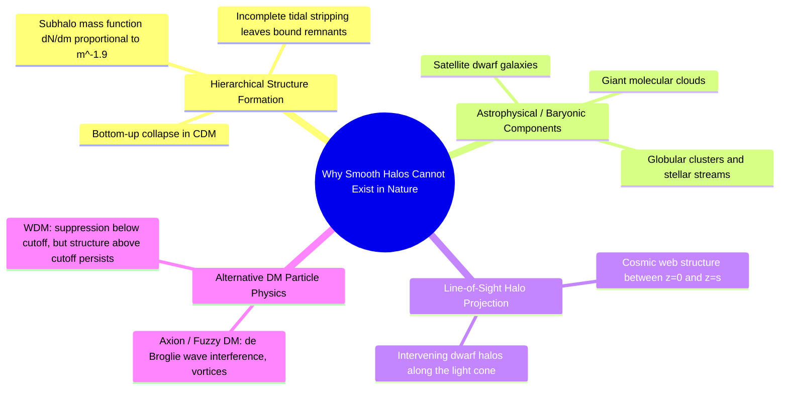

#### 1. Hierarchical Assembly in the Standard Cosmological Model ($\Lambda\text{CDM}$)
In Cold Dark Matter cosmology, structure formation proceeds **hierarchically (bottom-up)**:
- Primordial density fluctuations $\delta = \delta\rho/\rho$ generated during inflation collapse under gravity.
- Smaller-mass perturbations collapse first at high redshifts ($z \sim 20-30$), forming tiny micro-halos and dwarf halos.
- Larger galaxy-scale halos ($M \sim 10^{12} M_\odot$) assemble later via successive mergers and continuous accretion of these pre-existing smaller halos.
- As smaller halos fall into the gravitational potential of the host galaxy, they experience dynamic friction and tidal stripping forces. However, **tidal disruption is incomplete**. High-density central cores survive as **bound subhalos**.
- The predicted subhalo mass function follows an unbroken power law down to the free-streaming cutoff of the dark matter particle:
  $$\frac{dN}{dm} \propto m^{-\alpha}, \quad \text{with } \alpha \approx 1.85 - 1.95$$
  This implies that for every large satellite galaxy (like the Magellanic Clouds or Fornax around the Milky Way), there exist tens of thousands of dark subhalos in the mass range $10^6 - 10^8 M_\odot$ within the host halo virial volume.

#### 2. Line-of-Sight (LOS) Halos Along the Light Cone
Even if a host lens galaxy were miraculously stripped of every internal subhalo, strong gravitational lensing does not occur in an isolated box. Photons travel billions of light-years across the cosmic web from redshift $z_s \sim 1-3$ to $z=0$:
- All intervening dark matter halos, filamentary structures, and dwarf galaxies situated along the optical tube (the light cylinder) between observer, lens, and source contribute to gravitational deflection.
- These line-of-sight halos project onto the lens plane as effective localized perturbations, causing astrometric and flux-ratio anomalies that mimic or compound local subhalos.

#### 3. Inevitable Baryonic Substructures
Galaxies are not composed solely of smooth dark matter halos:
- They host baryonic substructures: globular clusters ($10^4 - 10^6 M_\odot$), satellite dwarf galaxies, giant molecular cloud complexes, stellar bars, spiral arms, and tidally disrupted stellar streams.
- These baryonic clumps introduce gravitational potential perturbations on kiloparsec and sub-kiloparsec scales.

#### 4. Alternative Dark Matter Models Always Exhibit Perturbations
- **Axions / Ultralight "Fuzzy" Dark Matter (ULDM/FDM, $m \sim 10^{-22}\text{ eV}$)**:
  Because the de Broglie wavelength is macroscopic ($\lambda_{\text{dB}} \sim \text{kpc}$), axions behave as a Bose-Einstein Condensate (BEC) governed by the Schrödinger-Poisson equations. Interference of wave packets produces continuous $O(1)$ density granules and topological **phase vortices** (regions of zero density and circulating velocity phase) throughout the entire halo. A smooth potential is physically impossible under wave mechanics.
- **Warm Dark Matter (WDM)**:
  WDM particles have thermal free-streaming velocities that wash out perturbations below a cutoff mass ($M_{\text{cut}} \sim 10^7 - 10^8 M_\odot$), but substructures above this threshold still exist.

#### Why Retain the "No Substructure" Class in DeepLense?
In machine learning and experimental astrophysics, **"no_sub" acts as the control / null hypothesis baseline**:
1. **Calibration of Signal vs. Smooth Macro-Model**: It enables the network to learn the macro-geometry of the unperturbed Einstein ring (dominated by the host galaxy profile).
2. **Measuring Detection Thresholds**: Subhalo perturbations introduce minute local surface brightness distortions (often $< 1-5\%$ of the ring flux). If an architecture cannot distinguish an unperturbed smooth ring from a perturbed ring, it cannot classify different dark matter types (Axion vs. CDM).

---

### 2.3 The Sérsic Light Profile in Depth

In Models II and III of the DeepLense dataset, the background source galaxy light is simulated using a **simple Sérsic profile**.

#### The Sérsic Mathematical Formulation
Formulated by astronomer José Luis Sérsic in 1963, the Sérsic law describes how the surface brightness (intensity $I$) of an astronomical system varies with projected radius $R$ from its center:

$$I(R) = I_e \exp \left( -b_n \left[ \left(\frac{R}{R_e}\right)^{1/n} - 1 \right] \right)$$

Alternatively expressed relative to the central surface brightness $I_0$:

$$I(R) = I_0 \exp \left( -b_n \left(\frac{R}{R_e}\right)^{1/n} \right), \quad \text{where } I_0 = I_e e^{b_n}$$

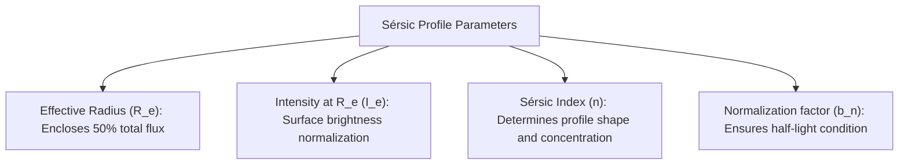

#### Parameter Definitions
1. **$R$**: Projected radial distance from the centroid of the galaxy ($R = \sqrt{x^2 + y^2}$).
2. **$R_e$ (Effective Radius / Half-Light Radius)**: The radius of the isophote containing exactly half ($50\%$) of the total light emitted by the galaxy:
   $$\int_0^{R_e} 2\pi R \, I(R) \, dR = \frac{1}{2} \int_0^\infty 2\pi R \, I(R) \, dR$$
3. **$I_e$**: The surface brightness (flux density per unit solid angle) measured at $R = R_e$.
4. **$n$ (Sérsic Index)**: A dimensionless parameter governing the concentration, curvature, and outer slope of the profile.
5. **$b_n$**: A dimensionless constant that depends strictly on $n$. It satisfies the incomplete gamma function identity:
   $$\Gamma(2n, b_n) = \frac{1}{2} \Gamma(2n)$$
   For computational implementations, $b_n$ is accurately approximated using the asymptotic series expansion (Ciotti & Bertin 1999):
   $$b_n \approx 2n - \frac{1}{3} + \frac{4}{405n} + \frac{46}{25515n^2} + \mathcal{O}(n^{-3})$$

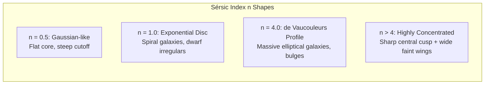

#### Physical Meaning of the Sérsic Index $n$
- **$n = 1$ (Exponential Profile)**:
  When $n=1$, $b_1 \approx 1.678$, and the formula simplifies to:
  $$I(R) = I_0 \exp(-1.678 R / R_e) = I_0 \exp(-R / R_d)$$
  where $R_d = R_e / 1.678$ is the exponential scale length. This describes the **stellar discs of spiral galaxies** (including the Milky Way) and dwarf spheroidals. In DeepLense, background sources are often modeled with $n=1$ as smooth spiral or disk galaxies.
- **$n = 4$ (de Vaucouleurs Profile, 1948)**:
  When $n=4$, $b_4 \approx 7.669$:
  $$I(R) = I_e \exp \left( -7.669 \left[ \left(\frac{R}{R_e}\right)^{1/4} - 1 \right] \right)$$
  This describes massive **elliptical galaxies** and classical central bulges formed by major mergers.
- **Low $n$ ($n < 1$)**: Represents galaxies with flat, low-density central cores and sharp outer edges.
- **High $n$ ($n > 4$)**: Represents galaxies with extreme central density cusps and very diffuse, extended power-law wings.

#### Elliptical Sérsic Profile in Lenstronomy
Real galaxies are not circular; they are elliptical. In `lenstronomy`, the source light profile is defined as `SERSIC_ELLIPSE`.
The radial coordinate $R$ is replaced by an elliptical coordinate:

$$R_{\text{ell}} = \sqrt{q x'^2 + \frac{y'^2}{q}}$$

where $q = b/a \in (0, 1]$ is the minor-to-major axis ratio, and $(x', y')$ are coordinates rotated by position angle $\phi$:

$$\begin{pmatrix} x' \\ y' \end{pmatrix} = \begin{pmatrix} \cos\phi & \sin\phi \\ -\sin\phi & \cos\phi \end{pmatrix} \begin{pmatrix} x - x_0 \\ y - y_0 \end{pmatrix}$$

In `lenstronomy`, the shape is parameterized by eccentricity components $(e_1, e_2)$ to avoid coordinate singularities:

$$e_1 = \frac{1-q}{1+q}\cos(2\phi), \quad e_2 = \frac{1-q}{1+q}\sin(2\phi)$$

As seen in `Simulations/lens.py` of DeepLense:
```python
kwargs_sersic = {
    'amp': 20, 
    'R_sersic': 0.25, 
    'n_sersic': 1, 
    'e1': -0.1, 
    'e2': 0.1,
    'center_x': center_x, 
    'center_y': center_y
}
```
This specifies an exponential disk ($n=1$) of radius $0.25''$, slightly inclined ($e_1=-0.1, e_2=0.1$), centered near the optical axis.

---

### 2.4 Telescope Observation Characteristics: Model I vs. Model II (Euclid) vs. Model III (HST)

The DeepLense benchmark evaluates three distinct dataset variations representing different instruments:

| Dataset | Dimensions | Physical Scale | Instrument Modeling | PSF Model | Target SNR / Noise Model |
| :--- | :--- | :--- | :--- | :--- | :--- |
| **Model I** | $150 \times 150$ | $0.05''/\text{pixel}$ | Synthetic Toy Simulation | Idealized Gaussian PSF | Fixed Gaussian + Background noise ($\text{SNR} \approx 25$) |
| **Model II** | $64 \times 64$ | $0.10''/\text{pixel}$ | **Euclid Space Telescope** (`VIS` band) | Gaussian PSF ($\text{FWHM} \approx 0.16''$) | Poisson shot noise + Zodiacal background + Readout noise |
| **Model III**| $64 \times 64$ | $0.08''/\text{pixel}$ | **Hubble Space Telescope (HST)** (`WFC3_F160W`) | Gaussian/TinyTim PSF ($\text{FWHM} \approx 0.151''$) | Full Poisson + IR detector noise + Sky background |

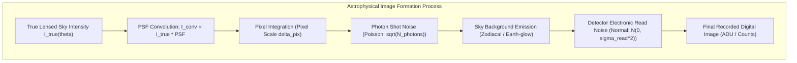

#### Detailed Breakdown of HST Observation Characteristics (Model III)
Modeled via `lenstronomy.SimulationAPI.ObservationConfig.HST` using the **WFC3 (Wide Field Camera 3) F160W filter** (near-infrared, central wavelength $\lambda \approx 1.536\ \mu\text{m}$, bandwidth $\Delta\lambda \approx 0.268\ \mu\text{m}$):

1. **Pixel Scale ($0.08''/\text{pixel}$ - $0.13''/\text{pixel}$)**:
   - The native physical pixel size of the WFC3 IR detector is $18\ \mu\text{m}$, yielding a native pixel scale of $\approx 0.128''/\text{pixel}$.
   - In standard astronomical pipelines, multiple dithered exposures are combined using the **Drizzle algorithm** (`astrodrizzle`), producing resampled images with pixel scales of $0.06'' - 0.08''/\text{pixel}$.
   - Model III uses $0.08''/\text{pixel}$ on a $64 \times 64$ grid, covering a field of view of $64 \times 0.08'' = 5.12'' \times 5.12''$.
2. **Point Spread Function (PSF)**:
   - For a circular telescope aperture of diameter $D = 2.4\text{ m}$, diffraction sets the angular resolution limit:
     $$\theta \approx 1.22 \frac{\lambda}{D} \approx 1.22 \times \frac{1.6 \times 10^{-6}\text{ m}}{2.4\text{ m}} \approx 0.81\ \mu\text{rad} \approx 0.17''$$
   - In Model III, the PSF is parameterized as a Gaussian kernel with **$\text{FWHM} \approx 0.151''$** (Full Width at Half Maximum).
   - **Astrophysical Impact**: A subhalo of mass $10^7 M_\odot$ produces lensing perturbations on scales of $\sim 0.05'' - 0.1''$. Because the HST PSF FWHM is $\approx 0.15''$, the telescope optics blur and smooth out these sharp subhalo signatures into the broad Einstein arc!
3. **Noise Architecture**:
   The total observed signal in electrons $S_{e^-}$ per pixel is modeled by:
   $$S_{e^-} \sim \text{Poisson}( (I_{\text{source}} + I_{\text{lens\_light}} + I_{\text{sky}}) \cdot t_{\text{exp}} ) + \mathcal{N}(0, \sigma_{\text{read}}^2 \cdot N_{\text{exp}})$$
   - **Photon Shot Noise (Poisson)**: Light arrives as discrete photons governed by Poisson statistics. For flux $F$, variance equals the mean: $\sigma_{\text{photons}} = \sqrt{F \cdot t_{\text{exp}}}$.
   - **Sky Background**: Thermal emission from HST's primary mirror and zodiacal dust light scattered in the solar system. For F160W, sky surface brightness is $\approx 22.1\ \text{mag}/\text{arcsec}^2$.
   - **Readout Noise ($\sigma_{\text{read}} \approx 15-20\ e^-/\text{pixel}$)**: Electronic noise introduced by the capacitive sense amplifiers during CCD/IR array readout.
   - **Dark Current ($0.05\ e^-/\text{pixel}/\text{sec}$)**: Thermally generated electron accumulation during long exposures.
   - **Exposure Time ($t_{\text{exp}} \sim 1200 - 2400\text{ s}$)**: Simulated to mimic typical 1-2 orbit HST pointings.

---

## 3. Deep Learning Pipeline & Code Architecture Walkthrough

### 3.1 How `train.py` Works: Step-by-Step Architecture

The file `train.py` provides the end-to-end training and validation loop, integrated with **Weights & Biases (W&B)** for experiment tracking and metric logging.

```mermaid
flowchart TD
    Start([Execute train.py]) --> ParseArgs[1. Parse CLI Arguments]
    ParseArgs --> WandBInit[2. Initialize Weights & Biases Run]
    WandBInit --> SeedSetup[3. Set Deterministic Random Seed]
    SeedSetup --> DeviceSelect[4. Select Hardware Device: CUDA / MPS / CPU]
    DeviceSelect --> BuildModel[5. Build Timm Model & Classification Head]
    BuildModel --> MultiGPU{Multiple GPUs?}
    MultiGPU -- Yes --> DataParallel[Wrap model with torch.nn.DataParallel]
    MultiGPU -- No --> LoadData[6. Instantiate LensDataset]
    DataParallel --> LoadData
    LoadData --> SplitData[7. 90/10 Train-Val Split]
    SplitData --> ApplyTransforms[8. Apply CenterCrop & Resizing Transforms]
    ApplyTransforms --> CreateLoaders[9. Construct PyTorch DataLoaders]
    CreateLoaders --> SetupOptSched[10. Configure Optimizer & Scheduler]
    SetupOptSched --> TrainingLoop[11. Execute Epoch Training Loop]
    TrainingLoop --> TrainStep[12. Forward Pass + CrossEntropy + Backprop]
    TrainStep --> CheckInterval{batch_num % log_interval == 0?}
    CheckInterval -- Yes --> EvalVal[13. Evaluate on Validation Set]
    EvalVal --> LogMetrics[14. Log Loss, Acc, AUROC to W&B]
    LogMetrics --> CheckBest{val_macro_auroc > best_val_auroc?}
    CheckBest -- Yes --> SaveCheckpoint[Save best_model.pt to disk]
    CheckBest -- No --> NextBatch[Next Batch]
    SaveCheckpoint --> NextBatch
    CheckInterval -- No --> NextBatch
    NextBatch --> LoopComplete{All Epochs Done?}
    LoopComplete -- No --> TrainingLoop
    LoopComplete -- Yes --> ReturnBest[Return Best Validation Metrics & End]
```

#### Detailed Execution Steps
1. **Argument Parsing**:
   Uses `argparse` to ingest hyperparameters (model name, batch size, learning rate, dataset choice, optimizer, classifier head complexity).
2. **W&B Run Initialization**:
   Initiates `wandb.init(entity="_archil", project=..., group=..., job_type=...)`. Groups are formatted as `timm-{model_name}` or `timm-{model_name}-complex`.
3. **Reproducibility**:
   `set_seed(run_config.seed)` sets fixed seeds for Python `random`, `numpy`, PyTorch CPU, and PyTorch CUDA, and forces `torch.backends.cudnn.deterministic = True`.
4. **Device Detection**:
   `get_device()` dynamically selects `"cuda"` (NVIDIA GPU), `"mps"` (Apple Silicon Metal), `"tpu"` (via PyTorch XLA), or falls back to `"cpu"`. If multiple CUDA GPUs exist, wraps the model in `torch.nn.DataParallel(model)`.
5. **Model Instantiation**:
   Looks up the target resolution in `TIMM_IMAGE_SIZE` (defined in `constants.py`). Calls `get_timm_model()` to instantiate either `TimmModelSimple` or `TimmModelComplex` with 1 input channel (`in_chans=1`) and 3 output classes (`num_classes=3`).
6. **Data Loading & Preprocessing**:
   - `LensDataset` scans `./data/{dataset}/train/` and indexes paths for classes `axion`, `cdm`, `no_sub`.
   - `random_split` performs a deterministic $90\% / 10\%$ train/validation split.
   - `WrapperDataset` binds the appropriate `get_transforms()` pipeline to each subset.
7. **Optimization Setup**:
   - Optimizer: `AdamW` (default with `weight_decay=0.01`), `Adam`, or `SGD`.
   - Loss Function: `torch.nn.CrossEntropyLoss()`.
   - Scheduler: Optional `CosineAnnealingWarmRestarts` with $T_0=15$, $T_{\text{mult}}=1$, $\eta_{\min}=10^{-6}$.
8. **Forward-Backward Step (`train_step`)**:
   Sends batch to device, resets gradients (`optimizer.zero_grad()`), computes forward pass logits, evaluates cross-entropy loss, runs `loss.backward()`, updates weights (`optimizer.step()`), and updates scheduler.
9. **Validation & Logging**:
   Every `log_interval` batches, calls `evaluate()` to compute validation loss, accuracy, micro-AUROC, macro-AUROC, and class-wise AUROC.
   Saves `best_model.pt` whenever `val_macro_auroc` sets a new record.

---

### 3.2 Exhaustive CLI Arguments & Parameter Definitions

The arguments in `train.py` (lines 180–228) control all experiment variables:

| Argument | Type | Default | Choices / Format | Conceptual Meaning & Physical/Engineering Rationale |
| :--- | :--- | :--- | :--- | :--- |
| `--dataset` | `str` | `"Model_I"` | `Model_I`, `Model_II`, `Model_III`, `Model_IV` | **Dataset choice**: Sets image size ($150\times 150$ for I vs $64\times 64$ for II/III) and instrument characteristics (synthetic Gaussian vs Euclid vs HST). |
| `--model_name`| `str` | `"vit_base_patch16_224"`| Any valid `timm` model name | **Backbone architecture**: Specifies which vision model from the `timm` library to instantiate (e.g. `coatnet_nano_rw_224`, `botnet26t_256`, `crossvit_small_240`). |
| `--complex` / `--no-complex`| `bool` | `True` | Flag (`--complex` or `--no-complex`) | **Classifier head depth**: `False` uses the native single linear layer from `timm`. `True` appends a 4-stage deep MLP with PReLU, BatchNorm, and Dropout. |
| `--pretrained` / `--no-pretrained`| `bool` | `True` | Flag | **Weight initialization**: `True` downloads ImageNet-1k/21k pre-trained weights. `False` trains all weights randomly from scratch. |
| `--tune` / `--no-tune` | `bool` | `True` | Flag | **Backbone fine-tuning**: `True` updates all model weights end-to-end. `False` freezes the backbone (`requires_grad = False`) and trains only the classification head. |
| `--batchsize` | `int` | `64` | Positive integer | **Mini-batch size**: Number of lensing images evaluated per forward/backward pass. |
| `--lr` | `float` | `3e-4` | Float (e.g. `0.0003`) | **Initial Learning Rate**: Step size taken along the negative loss gradient. |
| `--dropout` | `float` | `0.3` | Float $\in [0, 1)$ | **Dropout rate**: Fraction of neurons randomly zeroed during training in the classifier head to prevent overfitting. |
| `--optimizer` | `str` | `"adamw"` | `"sgd"`, `"adam"`, `"adamw"` | **Optimization algorithm**: `adamw` decouples weight decay from gradient updates, stabilizing transformer training. |
| `--decay_lr` / `--no-decay_lr`| `bool` | `False` | Flag | **Learning rate schedule**: `True` activates `CosineAnnealingWarmRestarts` with period $T_0=15$ epochs, preventing premature convergence to local minima. |
| `--epochs` | `int` | `25` | Positive integer | **Total epochs**: Number of complete iterations over the entire 90% training dataset. |
| `--random_zoom`| `float`| `1.0` | Float $\le 1.0$ | **Augmentation**: Scale factor for `transforms.RandomResizedCrop`. $1.0$ disables cropping. |
| `--random_rotation`| `float`| `0.0` | Degrees (e.g. `90.0`) | **Augmentation**: Angle range for `transforms.RandomRotation` (astrophysical lensing images are rotationally invariant). |
| `--log_interval`| `int` | `100` | Positive integer | **Logging frequency**: Number of training batches executed between validation evaluations and W&B logging steps. |
| `--project` | `str` | `"ml4sci_deeplense_final"`| String | **W&B project namespace**: Weights & Biases workspace where runs and artifacts are stored. |
| `--device` | `str` | `"best"` | `"cpu"`, `"mps"`, `"cuda"`, `"tpu"`, `"best"` | **Compute device**: Manually specify GPU/TPU/CPU or let the script auto-detect the fastest available hardware. |
| `--seed` | `int` | `None` | Integer (e.g. `42`) | **Random Seed**: Seeds Python, NumPy, and PyTorch RNGs for reproducible splits and training. |

---

### 3.3 Dataset Pipeline, Preprocessing, and Center-Cropping Rationale

The data loading pipeline is implemented in `data.py`:

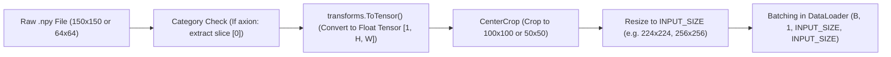

#### Why Center-Crop?
In `data.py` (lines 104–107):
```python
if initial_size == 150:    # Model I
    transform_pipeline.append(transforms.CenterCrop(100))
else:                      # Model II and Model III (64x64)
    transform_pipeline.append(transforms.CenterCrop(50))
```

1. **Astrophysical Focus**: Strong gravitational lensing arcs and Einstein rings form strictly within the Einstein radius $\theta_E$ around the center of the lens galaxy (typically within $r \le 1.5''$).
2. **Noise Elimination**: The outer borders of the image grid consist almost exclusively of empty sky background noise and detector read noise.
3. **Signal-to-Noise Ratio (SNR) Optimization**: Center-cropping from $150 \to 100$ or $64 \to 50$ discards uninformative border pixels, ensuring that transformer patch tokens are densely allocated to the physical Einstein ring and subhalo distortions rather than background noise.

#### Handling Single-Channel Images and Axion Metadata
- Astronomy images are monochromatic (single filter intensity maps, `in_chans=1`). Standard computer vision models expect 3-channel RGB. `timm.create_model(..., in_chans=1)` modifies the first convolution layer or patch projection layer to accept a single input channel.
- In `LensDataset.__getitem__`:
  ```python
  image = np.load(image_path, allow_pickle=True)
  if category == "axion":
      image = image[0]
  ```
  Simulation files for axions contain a 2-element tuple: `(image_array, axion_mass)`. The preprocessing extracts `image[0]` for classification.

---

### 3.4 Classification Heads: Simple vs. Complex MLP

Implemented in `models/timm_model.py`:

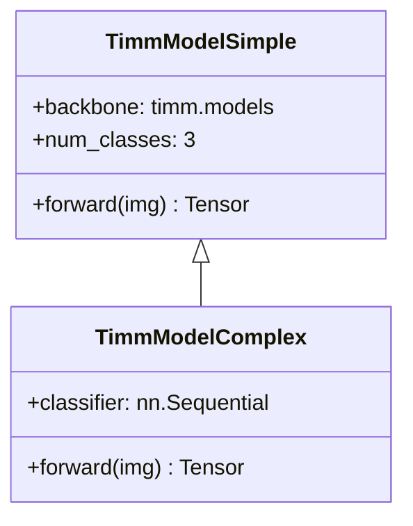

#### Simple Head (`TimmModelSimple`)
Uses the default linear projection layer built into the `timm` backbone:
$$\mathbf{z} = \mathbf{W} \mathbf{x}_{\text{pool}} + \mathbf{b}, \quad \mathbf{W} \in \mathbb{R}^{3 \times D}$$
where $D$ is the embedding dimension of the backbone.

#### Complex Head (`TimmModelComplex`)
For complex features, `TimmModelComplex` appends an expressive, regularized multi-stage MLP head:

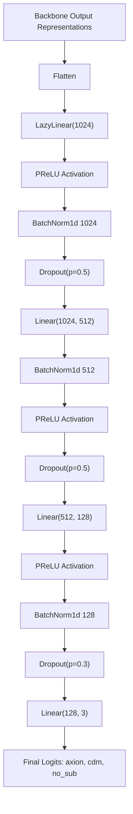

#### Why use `LazyLinear` and `PReLU`?
- **`LazyLinear(1024)`**: Different `timm` backbones output feature representations of varying dimensions (e.g., 192 for `convit_tiny`, 384 for `crossvit_small`, 768 for `vit_base`). `LazyLinear` automatically infers the input dimension upon receiving the first dummy tensor pass in `train.py` (line 102):
  ```python
  _ = model(next(iter(train_loader))[0].to(device, dtype=torch.float))
  ```
- **`PReLU` (Parametric ReLU)**: Unlike standard ReLU which zeroes all negative values ($f(x) = \max(0, x)$), PReLU introduces a learnable slope parameter $\alpha$:
  $$f(x) = \max(0, x) + \alpha \min(0, x)$$
  This prevents "dying neuron" syndrome during fine-tuning on subtle subhalo distortions.
- **`BatchNorm1d` + `Dropout`**: Normalizes internal activations across mini-batches and randomly masks hidden units ($50\%$ in early layers, $30\%$ in later layers) to prevent the deep head from overfitting to specific lens geometries.

---

## 4. How Results and Metrics are Formed & Calculated

The evaluation pipeline in `eval.py` produces the metrics logged to W&B and rendered in result plots.

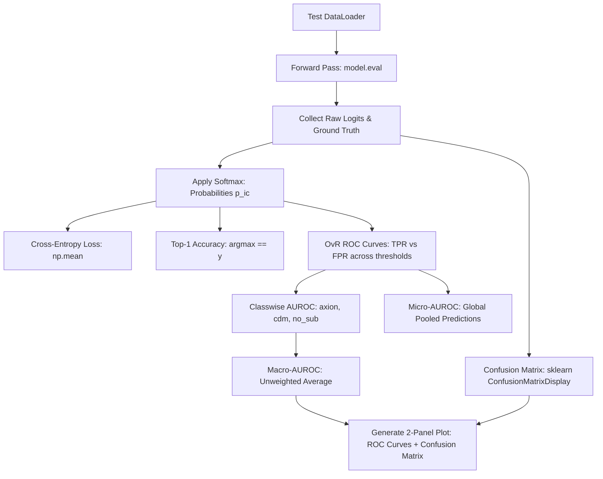

### 4.1 Logits to Probabilities via Softmax

The network outputs unnormalized real-valued logits $\mathbf{z}_i = [z_{i,0}, z_{i,1}, z_{i,2}]$ for each image $i$, where the classes correspond to:
$$0: \text{axion}, \quad 1: \text{cdm}, \quad 2: \text{no\_sub}$$

The **Softmax function** maps logits to a valid probability distribution $p_{ic} \in (0, 1)$ such that $\sum_{c=0}^2 p_{ic} = 1$:

$$p_{ic} = \frac{\exp(z_{ic})}{\sum_{k=0}^{2} \exp(z_{ik})}$$

---

### 4.2 Cross-Entropy Loss Calculation

For a test set of $N$ images with ground truth class $y_i \in \{0, 1, 2\}$, the **Categorical Cross-Entropy Loss** is:

$$\mathcal{L} = -\frac{1}{N} \sum_{i=1}^N \ln(p_{i, y_i}) = -\frac{1}{N} \sum_{i=1}^N \left[ z_{i, y_i} - \ln\left( \sum_{k=0}^2 \exp(z_{ik}) \right) \right]$$

Cross-entropy penalizes confident wrong predictions with high loss values ($-\ln(p) \to \infty$ as $p \to 0$).

---

### 4.3 Accuracy Metric

Top-1 classification accuracy measures the proportion of test images correctly predicted:

$$\hat{y}_i = \arg\max_{c \in \{0, 1, 2\}} p_{ic}$$

$$\text{Accuracy} = \frac{1}{N} \sum_{i=1}^N \mathbb{I}(\hat{y}_i = y_i)$$

where $\mathbb{I}(\cdot)$ is the indicator function ($1$ if true, $0$ if false).

---

### 4.4 ROC Curves (Receiver Operating Characteristic)

Accuracy alone can be misleading in scientific classification where confidence thresholds vary. The **ROC Curve** evaluates the diagnostic capability of the model across all possible classification decision thresholds $\tau \in [0, 1]$.

For each class $c \in \{\text{axion}, \text{cdm}, \text{no\_sub}\}$, the problem is framed as **One-vs-Rest (OvR)**:
- Binary ground truth: $y_{ic}^* = 1$ if $y_i = c$, else $0$.
- Predicted score: $p_{ic}$.
- Binary decision at threshold $\tau$: $\hat{y}_{ic}^*(\tau) = 1$ if $p_{ic} \ge \tau$, else $0$.

As $\tau$ varies from $1$ down to $0$, we compute:

1. **True Positive Rate (TPR / Sensitivity / Recall)**:
   $$\text{TPR}_c(\tau) = \frac{\text{TP}_c(\tau)}{\text{TP}_c(\tau) + \text{FN}_c(\tau)} = \frac{\sum_{i=1}^N \mathbb{I}(p_{ic} \ge \tau \land y_{ic}^* = 1)}{\sum_{i=1}^N \mathbb{I}(y_{ic}^* = 1)}$$

2. **False Positive Rate (FPR / Fall-out)**:
   $$\text{FPR}_c(\tau) = \frac{\text{FP}_c(\tau)}{\text{FP}_c(\tau) + \text{TN}_c(\tau)} = \frac{\sum_{i=1}^N \mathbb{I}(p_{ic} \ge \tau \land y_{ic}^* = 0)}{\sum_{i=1}^N \mathbb{I}(y_{ic}^* = 0)}$$

The ROC curve plots $\text{TPR}_c(\tau)$ on the y-axis against $\text{FPR}_c(\tau)$ on the x-axis.

---

### 4.5 AUROC: Class-Wise, Macro, and Micro Calculation

The **Area Under the ROC Curve (AUROC)** equals the integral of the ROC curve:

$$\text{AUROC}_c = \int_0^1 \text{TPR}_c(\text{FPR}_c^{-1}(u)) \, du$$

**Statistical Interpretation**: The probability that the model will rank a randomly chosen positive sample higher than a randomly chosen negative sample:
$$\text{AUROC}_c = P(p_{ic}(\text{positive}) > p_{jc}(\text{negative}))$$
- An AUROC of **$0.50$** represents a random coin flip.
- An AUROC of **$1.00$** represents a perfect classifier.

#### Macro-AUROC vs. Micro-AUROC
In multi-class settings, `eval.py` computes both aggregations:

1. **Class-Wise AUROC**: Computed independently for each individual class:
   $$\text{AUROC}_{\text{axion}}, \quad \text{AUROC}_{\text{cdm}}, \quad \text{AUROC}_{\text{no\_sub}}$$
2. **Macro-AUROC**: The unweighted arithmetic mean of the class-wise AUROCs:
   $$\text{Macro-AUROC} = \frac{1}{C} \sum_{c=1}^C \text{AUROC}_c = \frac{\text{AUROC}_{\text{axion}} + \text{AUROC}_{\text{cdm}} + \text{AUROC}_{\text{no\_sub}}}{3}$$
   *Macro-AUROC gives equal importance to all classes regardless of sample count.*
3. **Micro-AUROC**: Computed by pooling all one-hot encoded ground truth labels $y_{ic}^*$ and predicted probabilities $p_{ic}$ into a single flattened array of length $3N$, then evaluating a single global ROC curve:
   $$\text{Micro-AUROC} = \text{AUROC}(\text{flatten}(\mathbf{Y}^*), \text{flatten}(\mathbf{P}))$$
   *Micro-AUROC reflects global aggregate performance across all individual decisions.*

---

### 4.6 Confusion Matrix Construction

In `eval.py` (lines 186–193), a $3 \times 3$ confusion matrix $\mathbf{C}$ is plotted via `sklearn.metrics.ConfusionMatrixDisplay`:

$$C_{j, k} = \sum_{i=1}^N \mathbb{I}(y_i = j \land \hat{y}_i = k)$$

where row $j$ is the true class and column $k$ is the predicted class.

```
                  Predicted
               Axion   CDM   No_Sub
Actual  Axion [ C_00   C_01   C_02 ]
        CDM   [ C_10   C_11   C_12 ]
       No_Sub [ C_20   C_21   C_22 ]
```
- Diagonal entries ($C_{jj}$) indicate correct classifications.
- Off-diagonal entries ($C_{jk}, j \neq k$) reveal physical misclassifications:
  - If $C_{01}$ is high, the model confuses axion vortex interference with CDM point subhalos.
  - If $C_{12}$ is high, the model mistakes faint CDM subhalos for smooth lenses ("no_sub"), indicating a detection sensitivity limit.

---

## 5. Comprehensive Model Zoo & Architectural Breakdown

The project benchmarks **8 Vision Transformer families** and compares them against the **EfficientNet** CNN baseline.

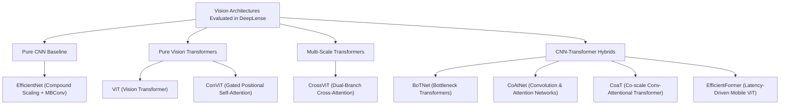

### 5.1 Inductive Bias: Convolutions vs. Self-Attention in Lensing

To understand why hybrid models excel on dark matter classification, we must compare their fundamental inductive biases:

| Property | Convolutional Neural Networks (CNNs) | Standard Vision Transformers (ViTs) | Hybrid Models (CoAtNet / BoTNet / CoaT) |
| :--- | :--- | :--- | :--- |
| **Inductive Bias** | **Strong**: Spatial locality, 2D translation equivariance | **Weak**: Free to learn any pairwise token interaction | **Balanced**: Local spatial bias in early stages, global reasoning in late stages |
| **Receptive Field** | Local (grows linearly with network depth) | Global from the very first layer ($O(N^2)$ interactions) | Local early on, global in deeper layers |
| **Weight Adaptability** | Static (fixed kernel weights after training) | Dynamic (weights conditioned on input query-key similarity) | Combines static local filters with dynamic global attention |
| **Data Efficiency** | High (trains well on small datasets) | Low (requires massive pretraining datasets like JFT-300M) | High (leverages CNN inductive bias to converge faster) |
| **Astrophysical Suitability** | Excellent at detecting local edges, rings, and noise | Excellent at correlating features across opposite sides of the Einstein ring | **Optimal**: Detects tiny subhalos locally while modeling global lens symmetry |

---

### 5.2 Vision Transformer (ViT)
*Dosovitskiy et al., 2020 — "An Image is Worth 16x16 Words"*

ViT proved that pure self-attention without any convolutions can achieve state-of-the-art image classification when trained on sufficient data.

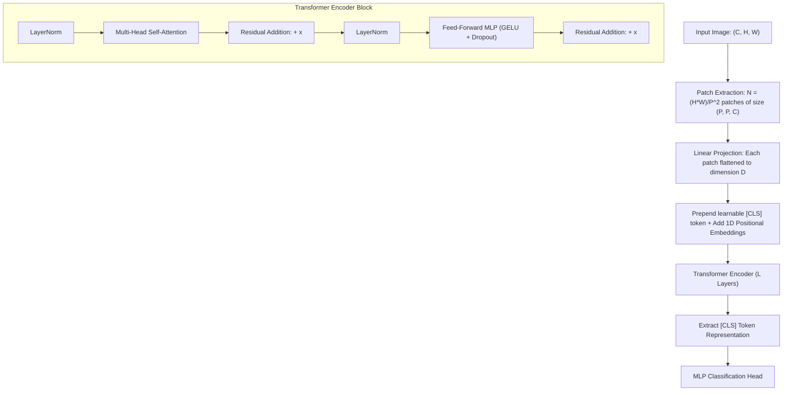

#### Mathematical Formulation
1. **Patch Tokenization**: An image $\mathbf{x} \in \mathbb{R}^{H \times W \times C}$ is divided into $N = HW/P^2$ non-overlapping patches $\mathbf{x}_p \in \mathbb{R}^{N \times (P^2 C)}$.
2. **Embedding & `[CLS]` Token**:
   $$\mathbf{z}_0 = \left[ \mathbf{x}_{\text{class}}; \, \mathbf{x}_p^1 \mathbf{E}; \, \mathbf{x}_p^2 \mathbf{E}; \, \dots; \, \mathbf{x}_p^N \mathbf{E} \right] + \mathbf{E}_{\text{pos}}$$
   where $\mathbf{E} \in \mathbb{R}^{(P^2 C) \times D}$ is the linear projection matrix, and $\mathbf{E}_{\text{pos}} \in \mathbb{R}^{(N+1) \times D}$ are learnable 1D position embeddings.
3. **Multi-Head Self-Attention (MHSA)**:
   For queries $\mathbf{Q}$, keys $\mathbf{K}$, and values $\mathbf{V}$:
   $$\text{Attention}(\mathbf{Q}, \mathbf{K}, \mathbf{V}) = \text{softmax}\left( \frac{\mathbf{Q} \mathbf{K}^T}{\sqrt{d_k}} \right) \mathbf{V}$$
4. **Behavior on Lensing Data**:
   Pure ViT (`vit_tiny_r_s16_p8_224`) performs well on Model I/III, but because it lacks local convolutional priors, it requires more epochs and careful regularization to reliably detect tiny, localized subhalos.

---

### 5.3 EfficientNet (Compound Scaling Baseline)
*Tan & Le, 2019 — "EfficientNet: Rethinking Model Scaling for Convolutional Neural Networks"*

Prior to EfficientNet, CNNs were scaled arbitrarily along one dimension: depth (e.g. ResNet-50 to ResNet-152), width (WideResNet), or input resolution.

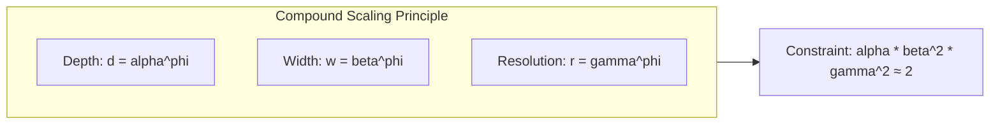

#### Compound Scaling Formulation
EfficientNet scales all three dimensions simultaneously using a compound coefficient $\phi$:

$$\text{depth: } d = \alpha^\phi, \quad \text{width: } w = \beta^\phi, \quad \text{resolution: } r = \gamma^\phi$$

$$\text{subject to: } \alpha \cdot \beta^2 \cdot \gamma^2 \approx 2, \quad \alpha \ge 1, \beta \ge 1, \gamma \ge 1$$

Because doubling depth doubles computation (FLOPs), while doubling width or resolution quadruples FLOPs ($\propto w^2, r^2$), this constraint ensures total computational cost scales predictably as $2^\phi$.

#### Core Building Block: MBConv with Squeeze-and-Excitation
The fundamental block is the **Mobile Inverted Bottleneck Convolution (MBConv)**:

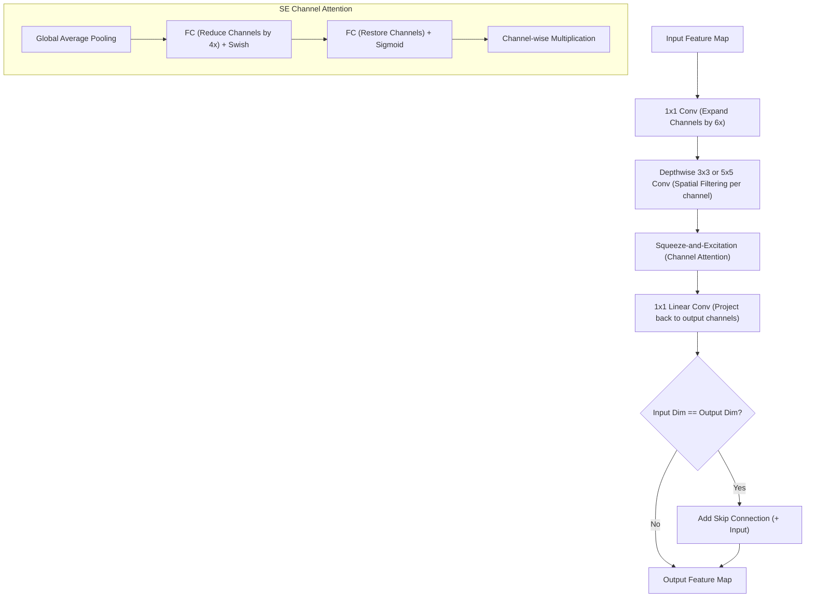

In DeepLense, `efficientnet_b1` serves as the high-performance pure-CNN baseline.

---

### 5.4 Bottleneck Transformers (BoTNet)
*Srinivasan et al., 2021 — "Bottleneck Transformers for Visual Recognition"*

BoTNet asks: *Why replace the entire convolutional network with self-attention when convolutions are already exceptionally good at low-level visual processing?*

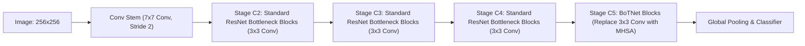

#### Architectural Mechanism
1. **Stages 1–3 (High Resolution)**: Use standard ResNet convolutional bottlenecks ($1\times 1 \to 3\times 3 \to 1\times 1$). This processes large spatial grids ($256\times 256 \to 32\times 32$) efficiently without the quadratic memory overhead of self-attention.
2. **Stage 4 (Low Resolution, High Semantics)**: Replaces the spatial $3\times 3$ convolution in the final 3 bottleneck blocks with **Multi-Head Self-Attention with 2D Relative Position Encodings (MHSA)**.

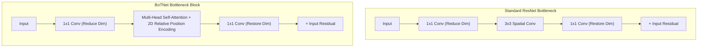

#### 2D Relative Position Encoding
Instead of static absolute position coordinates, BoTNet injects 2D relative position encodings into the attention matrix:

$$A_{i,j} = \mathbf{q}_i \mathbf{k}_j^T + \mathbf{q}_i \mathbf{r}_{j_y - i_y}^H + \mathbf{q}_i \mathbf{r}_{j_x - i_x}^W$$

where $\mathbf{r}^H$ and $\mathbf{r}^W$ are learnable relative position vectors along the vertical and horizontal axes.
- **Astrophysical Advantage**: Ideal for lensing. Convolutions in early stages handle telescope noise and trace the continuous arc curve; BoTNet's final MHSA stage correlates flux across opposite sides of the Einstein ring to detect subhalo perturbations.

---

### 5.5 CoaT (Co-scale Conv-attentional Transformer)
*Xu et al., ICML 2021 — "Co-scale Conv-Attentional Image Transformers"*

CoaT addresses two fundamental limitations of ViT:
1. ViT processes tokens at a single, fixed scale.
2. ViT self-attention scales quadratically with token count, making fine-grained patch processing computationally prohibitive.

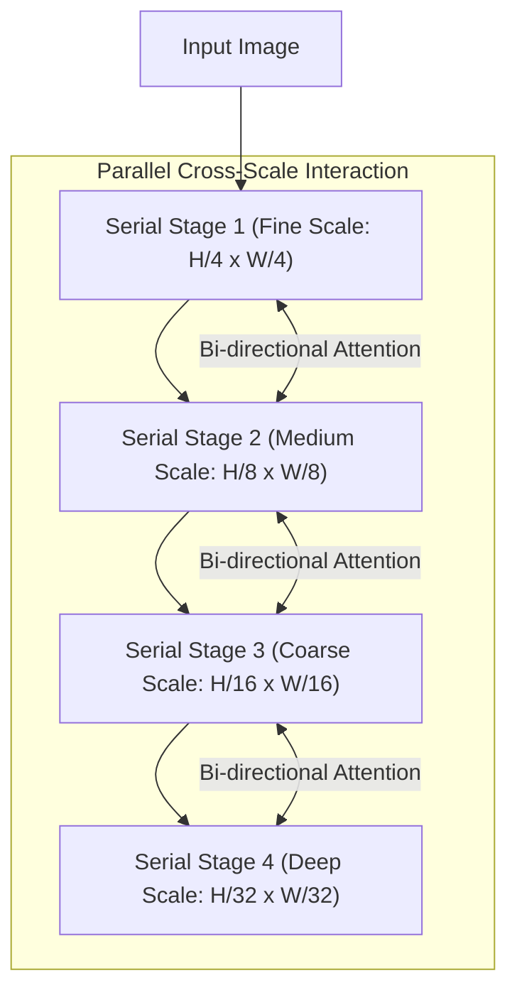

#### Key Innovations
1. **Co-Scale Cross-Attention**: Maintains parallel feature maps at multiple scales simultaneously. Information flows bidirectionally between fine-scale tokens (which capture localized subhalo perturbations) and coarse-scale tokens (which capture global Einstein ring geometry).
2. **Conv-Attentional Mechanism (Conv-FFN)**:
   Inserts a depthwise convolution directly inside the Feedforward Network (FFN):
   $$\mathbf{x}_{\text{out}} = \text{Linear}(\text{GELU}(\text{DepthwiseConv}_{3\times 3}(\text{Linear}(\mathbf{x}))))$$
   This embeds implicit 2D positional information into the feature representations at every layer, eliminating the need for brittle positional embeddings while enforcing local spatial continuity.

---

### 5.6 CoAtNet (Convolution and Attention Networks)
*Dai et al., NeurIPS 2021 — "CoAtNet: Marrying Convolution and Attention for All Data Sizes"*

CoAtNet presents a unified framework integrating convolutions and self-attention based on two principles:
1. Can depthwise convolution and self-attention share a common mathematical formulation?
2. What is the optimal sequence to order convolution and attention across network stages?

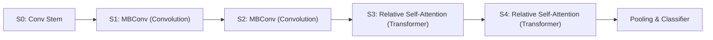

#### Unified Mathematical Formulation
Consider an input feature map $\mathbf{x}$. Both depthwise convolution and self-attention compute a weighted sum over a receptive field $\mathcal{R}$:

$$y_i = \sum_{j \in \mathcal{R}} w_{ij} x_j$$

- **Depthwise Convolution**: $w_{ij} = W_{i-j}$ (Static kernel weights dependent solely on relative spatial displacement, independent of input content).
- **Self-Attention**: $w_{ij} = \frac{\exp(x_i^T x_j)}{\sum_k \exp(x_i^T x_k)}$ (Dynamic weights dependent entirely on input content similarity, with no spatial distance prior).
- **CoAtNet Unified Relative Attention**:
  $$y_i = \sum_{j \in \mathcal{R}} \text{softmax} \left( \frac{x_i^T x_j}{\sqrt{d}} + b_{i-j} \right) x_j$$
  Here, $b_{i-j}$ is a learnable scalar relative position bias (acting as a convolutional filter), while $x_i^T x_j$ computes dynamic content attention!

#### The Optimal C-C-T-T Stage Sequence
After evaluating all 32 possible combinations of Conv (C) and Transformer (T) blocks across stages, the authors demonstrated that the **C-C-T-T** layout achieves superior convergence and generalization:
- **Stages $S_0, S_1, S_2$**: Use **MBConv** blocks to leverage strong inductive bias, low memory footprint, and fast execution on high-resolution maps.
- **Stages $S_3, S_4$**: Use **Relative Attention** blocks to capture global relational dependencies across semantic concepts.

In DeepLense, `coatnet_nano_rw_224` achieved exceptional AUROC and convergence speed across Models I, II, and III.

---

### 5.7 EfficientFormer (Latency-Driven Mobile Vision Transformer)
*Li et al., NeurIPS 2022 — "EfficientFormer: Vision Transformers at MobileNet Speed"*

While many transformers claim low parameter counts or FLOPs, their real-world inference latency on edge devices, CPUs, and GPUs is often significantly slower than CNNs due to:
- Frequent tensor memory reshapes (e.g. 4D image $\leftrightarrow$ 3D token sequences).
- High memory bandwidth overhead from non-fused LayerNorm and GELU operations.
- Quadratic complexity of standard attention.

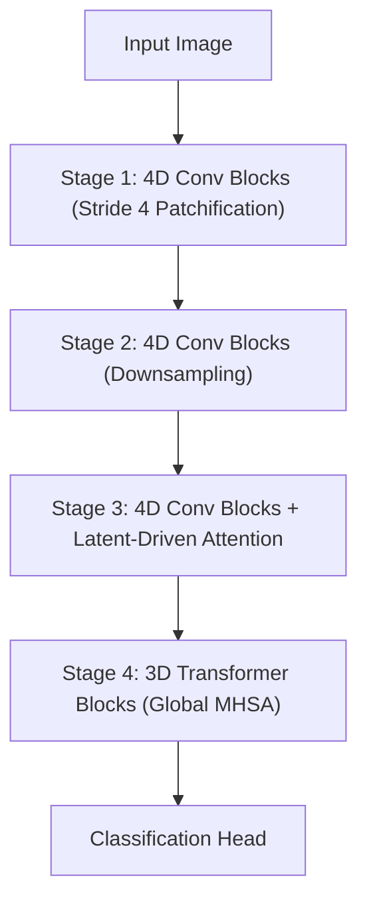

#### Architectural Mechanism
1. **4D Meta-Transformer Blocks (Early Stages)**: Operates strictly on 4D image tensors (`[B, C, H, W]`) using $3\times 3$ depthwise convolutions, $1\times 1$ pointwise convolutions, and BatchNorm. This avoids memory reshaping overhead entirely while maintaining peak GPU tensor-core throughput.
2. **Latent-Driven Self-Attention (Late Stages)**: To minimize self-attention latency, the query and key sequence lengths are subsampled, decoupling attention cost from the raw pixel count.
3. **Hardware-Friendly Design**: Replaces memory-bandwidth-heavy LayerNorm with fused BatchNorm in early stages.

In DeepLense, `efficientformer_l3` delivers transformer-level classification performance with the latency characteristics of a lightweight CNN.

---

### 5.8 CrossViT (Dual-Branch Cross-Attention Multi-Scale Transformer)
*Chen et al., ICCV 2021 — "CrossViT: Cross-Attention Multi-Scale Vision Transformer for Image Classification"*

In strong gravitational lensing, two vastly different spatial scales matter simultaneously:
1. The **global arc/ring curvature** (large spatial scale, tens of pixels).
2. The **localized subhalo distortion** (minute spatial scale, 1–3 pixels).

A standard ViT with fixed patch size (e.g. $16\times 16$) struggles to capture both scales simultaneously. CrossViT solves this by processing images through **two parallel branches at different patch resolutions**:

```mermaid
flowchart TD
    Img[Input Image] --> L_Branch["Large-Patch Branch (L-Branch: e.g. 16x16 Patches)"]
    Img --> S_Branch["Small-Patch Branch (S-Branch: e.g. 8x8 Patches)"]
    
    subgraph Cross_Attention_Fusion [Cross-Attention Token Fusion Module]
        L_Branch --> CLS_L["[CLS]_L Token"]
        S_Branch --> Tokens_S["Token Sequence X_S"]
        
        S_Branch --> CLS_S["[CLS]_S Token"]
        L_Branch --> Tokens_L["Token Sequence X_L"]
        
        CLS_L & Tokens_S --> CA1["Cross-Attention: [CLS]_L queries X_S"]
        CLS_S & Tokens_L --> CA2["Cross-Attention: [CLS]_S queries X_L"]
    end
    
    CA1 --> Out_L[Updated L-Branch Features]
    CA2 --> Out_S[Updated S-Branch Features]
    Out_L & Out_S --> Cat[Concatenate [CLS] Tokens & Classify]
```

#### Linear-Complexity Cross-Attention Fusion
Merging two token sequences of lengths $N_L$ and $N_S$ via full bidirectional attention requires $O(N_L \cdot N_S)$ operations, which is computationally prohibitive.
CrossViT solves this with **Asymmetric `[CLS]` Token Querying**:
- The single `[CLS]_L` token of the large branch acts as the Query $\mathbf{Q}$, interacting with the full token sequence $\mathbf{K}_S, \mathbf{V}_S$ of the small branch:
  $$\mathbf{x}_{\text{cls}, L}' = \text{Softmax}\left(\frac{\mathbf{q}_{\text{cls}, L} \mathbf{K}_S^T}{\sqrt{d}}\right) \mathbf{V}_S$$
- Symmetrically, the `[CLS]_S` token acts as the Query $\mathbf{Q}$, interacting with $\mathbf{K}_L, \mathbf{V}_L$.
- **Complexity**: $O(N_S) + O(N_L)$ (linear in token count!).
- **Astrophysical Advantage**: The large-patch branch provides macro-lens geometry, while the small-patch branch injects fine subhalo flux distortions directly into the decision token.

---

### 5.9 ConViT (Gated Positional Self-Attention Transformer)
*d'Ascoli et al., ICML 2021 — "ConViT: Improving Vision Transformers with Soft Convolutional Inductive Biases"*

ConViT bridges the gap between ViTs and CNNs by introducing a soft, learnable convolutional inductive bias without altering the pure self-attention architecture.

```mermaid
flowchart TD
    Input[Patch Embeddings] --> Split[Split into Attention Heads]
    Split --> ContentAttn["Content Attention: Q * K^T / sqrt(d)"]
    Split --> PosAttn["Positional Attention: Distance-based Gaussian Prior P_h"]
    
    ContentAttn & PosAttn --> Gating["Gated Positional Self-Attention (GPSA)"]
    
    subgraph Gated_Mechanism [Gated GPSA Mechanism]
        Gate["Learnable Gate Parameter: alpha_h in [0, 1]"]
        Formula["A_h = (1 - alpha_h) * ContentAttn + alpha_h * P_h"]
    end
    
    Gating --> Softmax[Softmax Normalization]
    Softmax --> MultiplyV[Multiply by Values V]
    MultiplyV --> Output[Combined Multi-Head Output]
```

#### Gated Positional Self-Attention (GPSA)
Standard multi-head attention computes attention solely from content similarity. ConViT modifies each head $h$ with a learnable gating parameter $\alpha_h \in [0, 1]$:

$$\mathbf{A}_{i,j}^h = \text{softmax}\left( (1 - \alpha_h) \frac{\mathbf{q}_i^h (\mathbf{k}_j^h)^T}{\sqrt{d}} + \alpha_h \mathbf{P}_{i,j}^h \right)$$

where $\mathbf{P}_{i,j}^h$ is a **positional attention matrix** initialized to mimic a 2D Gaussian convolution kernel centered on neighboring patches:

$$\mathbf{P}_{i,j}^h = -\frac{\|\vec{\delta}_{ij} - \vec{\Delta}_h\|^2}{2 \sigma_h^2}$$
- $\vec{\delta}_{ij}$: 2D coordinate displacement vector between patch $i$ and patch $j$.
- $\vec{\Delta}_h$: Learnable 2D center offset of head $h$.
- $\sigma_h$: Learnable spatial spread of head $h$.

#### Dynamic Learning of Inductive Bias
- At initialization, $\alpha_h \approx 1$: Every head behaves exactly like a **local 2D convolution** with localized Gaussian receptive fields.
- During training, the network can smoothly adjust $\alpha_h \to 0$ to transition any head into a **pure global self-attention** mechanism if the task demands long-range correlations.
- This gives ConViT the data efficiency and fast convergence of CNNs on small scientific datasets while preserving the expressive global modeling capacity of ViTs.

---

## 6. Comparative Summary & Takeaways for Dark Matter Inference

| Model Architecture | Model Family | Primary Building Blocks | Inductive Bias Level | Parameter Count | Key Strength for Lensing Tasks |
| :--- | :--- | :--- | :--- | :--- | :--- |
| **EfficientNet-B1** | Pure CNN | MBConv + SE Blocks | Very Strong | $\sim 7.8\text{M}$ | Exceptional local edge and noise modeling baseline. |
| **ViT-Tiny** | Pure ViT | Linear Patch + MHSA | Very Weak | $\sim 5.7\text{M}$ | Capable of global ring correlation, but sensitive to small data size. |
| **ConViT-Tiny** | Soft-Bias ViT | Gated Positional Self-Attention | Adaptable | $\sim 5.7\text{M}$ | Smoothly transitions from local convolution to global attention. |
| **CrossViT-Small**| Multi-Scale ViT | Dual-Branch + Cross-Attention | Weak–Moderate | $\sim 26.8\text{M}$ | Simultaneously resolves tiny subhalos and macro Einstein rings. |
| **BoTNet-26T** | CNN-Transformer Hybrid | ResNet Stages 1–3 + MHSA Stage 4 | Strong Early, Weak Late | $\sim 19.6\text{M}$ | Fast convolutional feature extraction with global self-attention classification. |
| **CoaT-Lite-Small**| Multi-Scale Conv-ViT | Conv-FFN + Factorized Attention | Moderate | $\sim 20.0\text{M}$ | Multiscale parallel representations with implicit convolutional positions. |
| **CoAtNet-Nano** | Hybrid Unified | MBConv (S1-S2) + RelAttn (S3-S4) | Optimal | $\sim 17.5\text{M}$ | **Top Performer**: Ideal balance of inductive bias, efficiency, and global reasoning. |
| **EfficientFormer-L3**| Mobile ViT | 4D Conv Blocks + Latent Attention | Strong Early, Weak Late | $\sim 31.3\text{M}$ | Ultra-fast inference with minimal memory latency overhead. |

### Key Physical & Engineering Takeaways
1. **The Superiority of Hybrids in Astrophysics**:
   Pure ViTs require massive pretraining to learn basic 2D spatial concepts like lines, arcs, and local continuity. In contrast, pure CNNs struggle to relate flux features across opposite sides of an Einstein ring. Hybrid models (**CoAtNet**, **BoTNet**, **CrossViT**) consistently achieve the highest AUROCs because their architectural design naturally mirrors the physics of strong gravitational lensing: **local subhalo perturbations embedded within a global lens potential**.
2. **Noise and PSF Resilience**:
   In Model III (HST simulation), the combination of instrumental PSF convolution and Poisson/read noise degrades fine subhalo signatures. Multi-scale models (like **CrossViT** and **CoaT**) demonstrate superior robustness by cross-referencing fine-scale features with the macro-scale light profile.
3. **The Role of the "No Substructure" Baseline**:
   While physical halos in $\Lambda\text{CDM}$ and alternative dark matter models are never purely smooth due to hierarchical assembly and line-of-sight structures, the simulated `no_sub` class remains essential as an experimental control to benchmark sensitivity thresholds and prevent models from hallucinating false subhalos.

---
*Document compiled for DeepLense research reference.*

